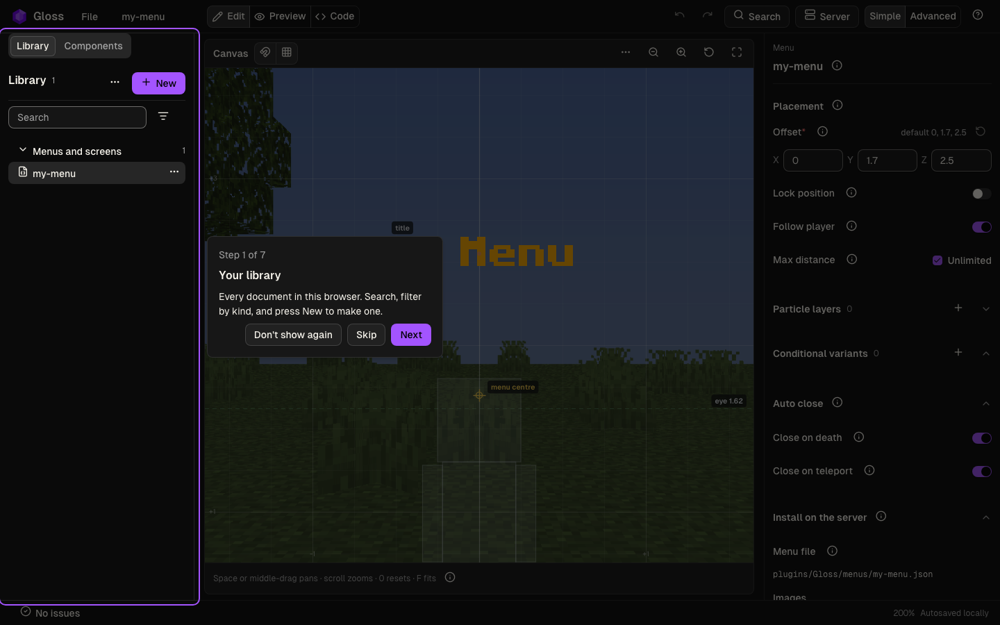
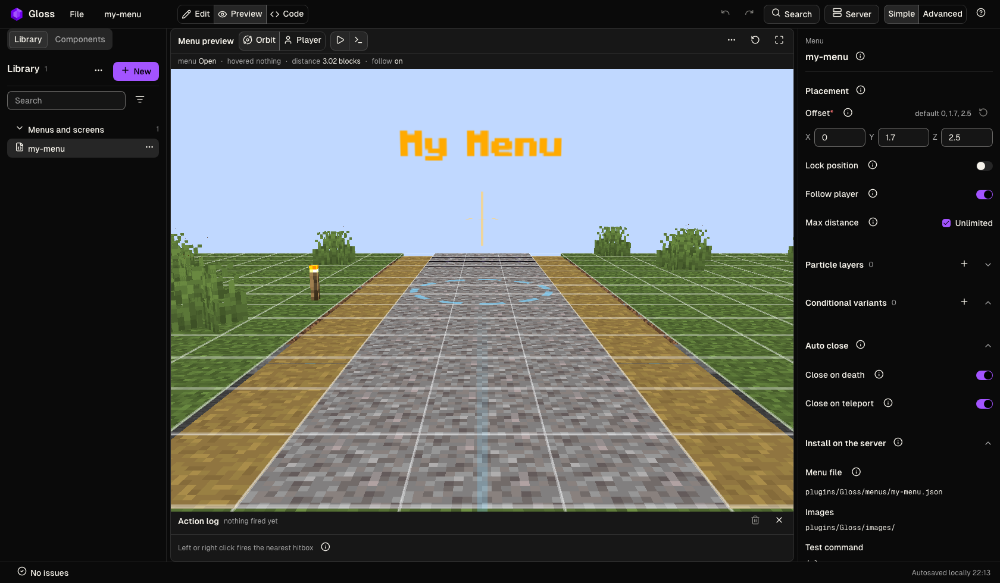
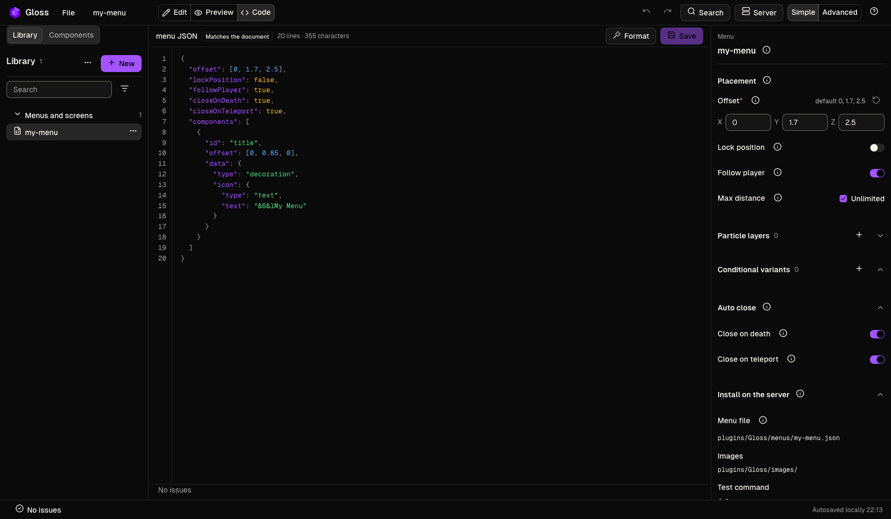
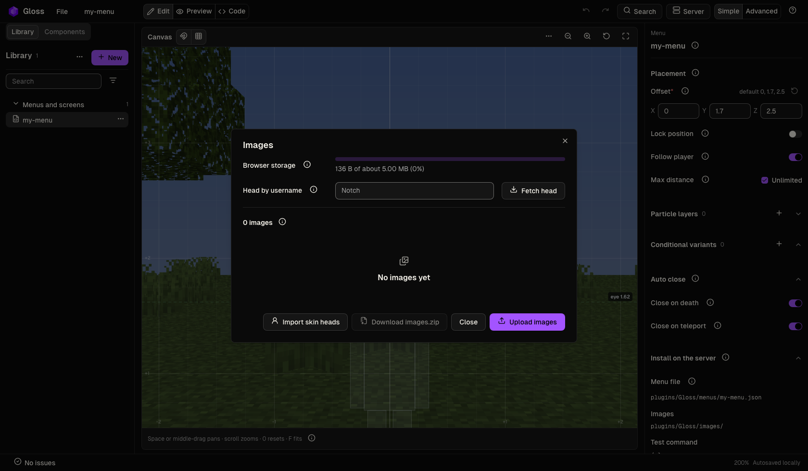
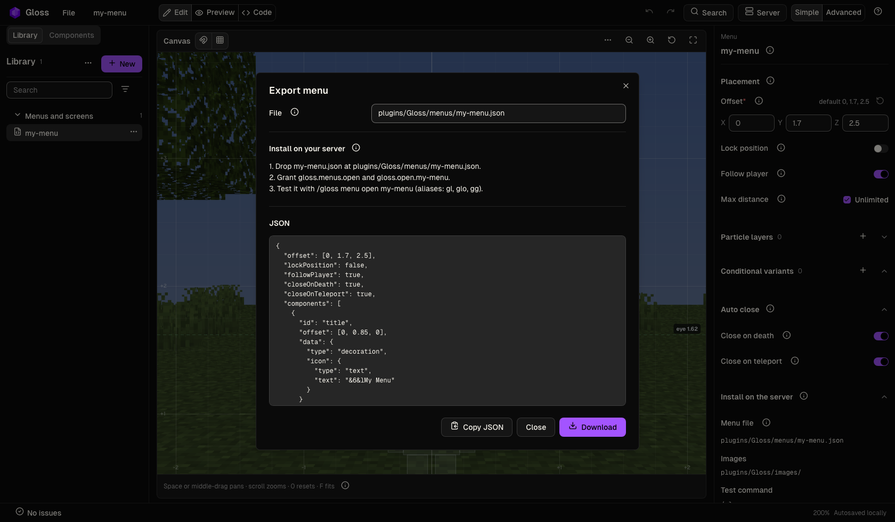
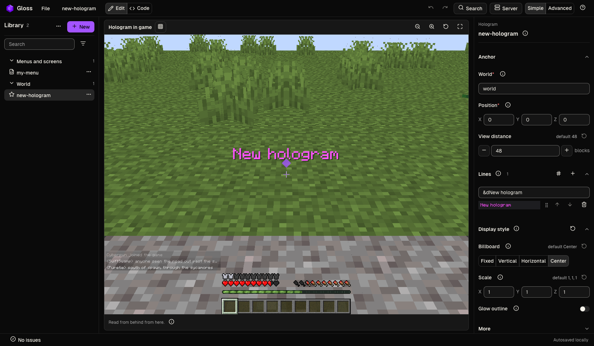
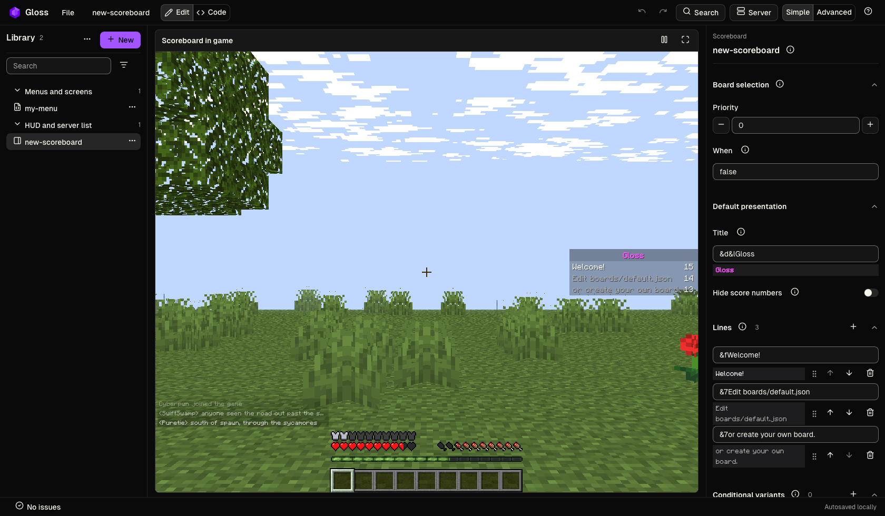
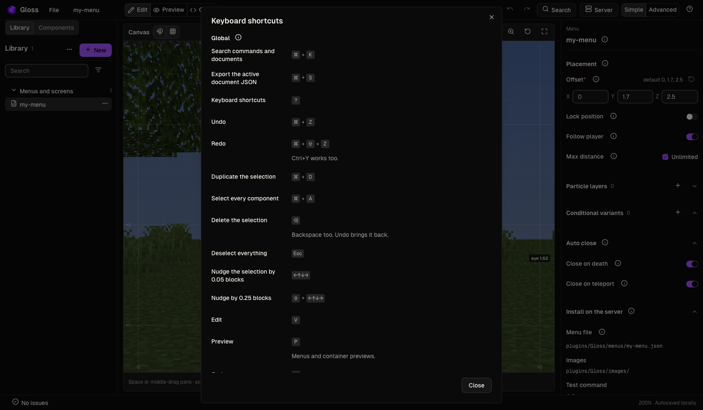

Use the [Gloss web editor](https://gloss.volmitsoftware.com/) to create menus, holograms, scoreboards, and other Gloss documents. This tutorial covers editing and previewing a document, then exporting its JSON for the server.

Pairing, publishing, and per-surface field lists live in [Web Editor & Sync](/gloss/18-web-editor).

## Open the editor

You can work in the browser with no server. Autosave stays in this browser. The server does not change until you export a file or publish from a paired server's workspace.

| How you open it | What you get |
|---|---|
| Visit [gloss.volmitsoftware.com](https://gloss.volmitsoftware.com/) | The start page. **New document** opens the browser workspace, which starts with a sample menu |
| `/gloss editor pair`, then open its link | A pairing card for your server. **Pair** opens the server's own workspace with all its documents listed |

A pairing link works once, within 10 minutes. Do not share it: it gives the browser that opens it access to the server's Gloss files. Pairing, scopes and tokens are covered in [Pairing](/gloss/18-web-editor#pairing).

## The first-run tour

The first time you open the editor, a tour walks it in seven steps: your library, the stage, the inspector, the views, Search, your server, and help and settings. The tour does not start in a server's workspace.

**Skip** closes it until the next visit; **Don't show again** and **Done** close it for good in this browser. Reopen it with **Help > Guided tour**.

## The library

The library on the left lists your documents under six groups: Menus and screens, HUD and server list, Chat, World, Players, and Shared resources. **Search** finds a document by title, runtime id or kind, and **Filter by kind** shows one kind at a time.

The status bar under the editor reports problems and autosave. Errors there mean Gloss will refuse or misread the file.

The **Simple** and **Advanced** switch in the top bar sets how much the editor shows. Simple hides expert fields, flow maps and the Shared resources kinds; Advanced shows everything. Fields Simple hides are kept in the file. See [Simple and Advanced](/gloss/18-web-editor#simple-and-advanced).

## Create a document

Select **New** in the library, or **File > New document**. Choose where to start:

- **Blank** makes an empty valid document.
- **Template** starts from a finished sample, such as a welcome hub or a shop row.
- **Random** generates a complete sample you can edit.

Then choose a kind under its group. The document opens at once, and the file you already had stays unchanged. **Cancel** closes the dialog without creating one.

## Views

<strong>Browser project workflow</strong> Browser editor. Silent capture. Browser editing and previews; game rendering is shown in the Minecraft client clips.

<video src="https://media.volmitsoftware.com/gloss-assets/demos/project-workflow-editor.webm" aria-label="Browser project workflow, browser editor" autoplay muted loop playsinline controls preload="metadata"></video>

The **View** switch sits in the top bar next to the document title. Choices a kind cannot use are not shown.

| View | Key | What it shows |
|---|---|---|
| Edit | `V` | The kind's own editing surface |
| Preview | `P` | The document as the server draws it. Menus and container previews only |
| Code | `C` | The runtime JSON |
| Split view | `S` | The surface and the JSON together. Advanced mode, wide screens |

**Edit** for a menu is the block canvas: drag a component to move it, scroll to zoom, space-drag or
middle-drag to pan. The canvas fits the menu when it opens and whenever the pane changes size, until
you zoom or pan; that view then stays with the document. **Reset view**, `0` or `F` fits it again.
The inspector edits the whole menu until you select a component, and each (i) beside a field explains
what Gloss does with it.

**Preview** places the layout in a rendered world; orbit-drag turns the camera, and the action log
records clicks instead of running them on a live server.

Other kinds, such as holograms and scoreboards, show one stage that is already the preview. Catalogs such as Names, Strings and Presets are edited in a form in the centre.

**Code** is the file Gloss will load. **Format** tidies the buffer, **Save** writes it back into the document, and the list under the code shows errors and warnings against the plugin contract.

## Images

<strong>Image library and import</strong> Browser editor. Silent capture. Browser editing and previews; game rendering is shown in the Minecraft client clips.

<video src="https://media.volmitsoftware.com/gloss-assets/demos/image-library-editor.webm" aria-label="Image library and import, browser editor" autoplay muted loop playsinline controls preload="metadata"></video>

Select **File > Images**. Choose **Upload images** for PNG or GIF files used by `textImage` icons, **Import skin heads** to turn a Minecraft skin into an 8x8 head, or type a name under **Head by username** and select **Fetch head**. **Download images.zip** and unzip it into `plugins/Gloss/images/`.

Uploaded images are scaled down to fit 16x16. The username is the only value sent to the skin host.

## Export and install

Select **File > Export menu JSON** (the item names the document's kind), or press `Cmd+S` (`Ctrl+S`). The dialog names the file, the install path, and the test command.

1. Select **Download**.
2. Drop the file at the path the dialog shows, such as `plugins/Gloss/menus/my-menu.json`.
3. Grant the permissions the dialog lists.
4. Run the test command, such as `/gloss menu open my-menu`.

Gloss watches most of those folders. You do not restart the server for a new menu file. In a paired server's workspace, **Publish** sends your changes without a download. See [Publish](/gloss/18-web-editor#publish).

## Other surfaces

A hologram uses a world stage instead of a menu canvas, with the anchor, lines and display style in the inspector.

A scoreboard uses a sidebar preview, with the title and lines in the inspector. Advanced mode adds show conditions, the layout editor and Row settings.

Tab list, MOTD, emoji, bubbles, damage indicators, entity overlays and real drops use the same layout; only the stage and the inspector fields change.

## Keyboard shortcuts

Press `?` or choose **Help > Keyboard shortcuts** for the full list. `Cmd+K` (or `Ctrl+K`) opens Search.

Useful chords:

| Action | Binding |
|---|---|
| Search | `Cmd+K` |
| Export | `Cmd+S` |
| Shortcut sheet | `?` |
| Undo / redo | `Cmd+Z` / `Cmd+Shift+Z` |
| Edit / Preview / Code / Split view | `V` / `P` / `C` / `S` |

Click the canvas or the 3D stage once before artboard and camera chords. Inside Code, `Cmd+S` saves the buffer instead of exporting.

## Next

- [Web Editor & Sync](/gloss/18-web-editor) for the top bar, pairing, publishing and per-surface fields
- [Hologram Menus](/gloss/09-menus) for menu JSON and open commands
- [Holograms](/gloss/04-holograms) for world text
- [Scoreboards & Groups](/gloss/05-scoreboards-groups) for sidebars
